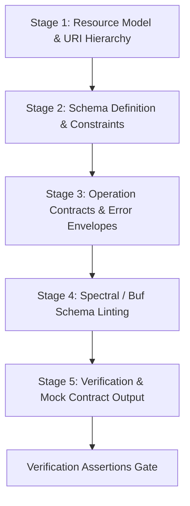

# API Contract-First Design Runbook

## 1. Objective
Enforce contract-first API development by defining, validating, and locking OpenAPI 3.1 or Protocol Buffers specifications *before* authoring client or server implementation code. This ensures zero breaking API drift, unambiguous serialization semantics, strict error typing, and deterministic client SDK / server stub generation.

This skill operates across **Class-0 (Read-Only)** for design analysis and **Class-1 (Idempotent Mutation)** for specification authoring.

---

## 2. Pre-Conditions & Constraints
- **Side-Effect Classification**: Class 0 (Analysis) / Class 1 (Contract File Writing).
- **Supported Formats**: OpenAPI 3.1.0 (YAML/JSON), AsyncAPI 2.6+, Protocol Buffers (proto3).
- **Single Source of Truth**: The contract file (e.g. `docs/api/openapi.yaml` or `proto/v1/service.proto`) is canonical; code is generated from or validated against it.
- **Breaking Change Rule**: Existing published endpoints must not remove fields, change field types, or alter status codes without explicit API versioning (`/v2/`).
- **Error Standard**: All HTTP error responses must adhere to RFC 7807 (Problem Details for HTTP APIs) or equivalent structured error schemas.

---

## 3. Deterministic 5-Stage Execution Protocol



### Stage 1: Resource Model & URI Hierarchy
1. Map domain entities to RESTful URI resources (nouns in plural form: `/api/v1/orders`, `/api/v1/users/{userId}/tokens`).
2. Identify idempotent HTTP methods (`GET`, `PUT`, `DELETE`) and non-idempotent methods (`POST`, `PATCH`).
3. Define query parameters for pagination (`limit`, `cursor`/`offset`), sorting (`sort_by`, `order`), and filtering.

### Stage 2: Schema Definition & Validation Constraints
1. Define JSON Schema / Protobuf message structures for all request bodies and response payloads.
2. Specify exact data types (`string`, `integer`, `boolean`, `number`), formats (`uuid`, `date-time`, `email`, `uri`), and constraints (`minLength`, `maxLength`, `pattern`, `minimum`, `maximum`).
3. Explicitly declare `required` properties. Disallow untyped freeform objects (`additionalProperties: false`).

### Stage 3: Operation Contracts & Error Envelopes
1. Define every valid HTTP response code per operation:
   - `200 OK` / `201 Created` / `204 No Content` for successes.
   - `400 Bad Request` with field-level validation errors.
   - `401 Unauthorized` & `403 Forbidden` for auth failures.
   - `404 Not Found` for missing resources.
   - `409 Conflict` for unique constraint violations or optimistic concurrency collisions.
   - `422 Unprocessable Entity` for domain validation failures.
   - `500 Internal Server Error` with correlation trace ID.
2. Ensure every error response maps to a standard `ProblemDetails` schema:
   ```yaml
   ProblemDetails:
     type: object
     required: [type, title, status, trace_id]
     properties:
       type: { type: string, format: uri }
       title: { type: string }
       status: { type: integer }
       detail: { type: string }
       instance: { type: string }
       trace_id: { type: string }
       errors:
         type: array
         items:
           type: object
           required: [field, message]
           properties:
             field: { type: string }
             message: { type: string }
   ```

### Stage 4: Spectral / Buf Schema Linting
1. Validate the specification using automated linter rules:
   ```bash
   # OpenAPI linting with Spectral
   npx @stoplight/spectral-cli lint docs/api/openapi.yaml --ruleset spectral:oas

   # Protobuf linting with Buf
   buf lint proto/
   ```
2. Verify:
   - All operations have unique `operationId` identifiers.
   - All parameters and response models have descriptions and example values.
   - Zero undocumented `default` fallback responses.

### Stage 5: Verification & Mock Contract Output
1. Generate mock responses or TypeScript types to verify contract usability:
   ```bash
   # TypeScript type generation verification
   npx openapi-typescript docs/api/openapi.yaml -o src/types/api.generated.ts
   ```

---

## 4. Standardized Output Schema & OpenAPI Template

When authoring or updating an OpenAPI specification, produce clean OpenAPI 3.1 YAML:

```yaml
openapi: 3.1.0
info:
  title: "<Service Name> API"
  version: "1.0.0"
  description: "Canonical contract for <Service Name>."
paths:
  /api/v1/resources:
    post:
      summary: "Create a new resource"
      operationId: "createResource"
      tags: ["Resources"]
      requestBody:
        required: true
        content:
          application/json:
            schema:
              $ref: "#/components/schemas/CreateResourceRequest"
      responses:
        "201":
          description: "Resource created successfully"
          content:
            application/json:
              schema:
                $ref: "#/components/schemas/ResourceResponse"
        "400":
          $ref: "#/components/responses/400BadRequest"
        "401":
          $ref: "#/components/responses/401Unauthorized"
        "422":
          $ref: "#/components/responses/422ValidationError"
components:
  schemas:
    CreateResourceRequest:
      type: object
      additionalProperties: false
      required: [name, category]
      properties:
        name:
          type: string
          minLength: 1
          maxLength: 128
          example: "Primary Gateway"
        category:
          type: string
          enum: [standard, enterprise, internal]
    ResourceResponse:
      type: object
      required: [id, name, category, created_at]
      properties:
        id:
          type: string
          format: uuid
        name:
          type: string
        category:
          type: string
        created_at:
          type: string
          format: date-time
  responses:
    400BadRequest:
      description: "Invalid request payload"
      content:
        application/problem+json:
          schema:
            $ref: "#/components/schemas/ProblemDetails"
```

---

## 5. Verification Assertions & Exit Criteria

Before finalizing contract authoring, verify all four assertions:

1. **[Assertion VA-API-01: Linter Zero Errors]**: Spectral/Buf CLI linter passes with 0 errors and 0 warnings.
2. **[Assertion VA-API-02: Complete Status Coverage]**: Every endpoint defines explicit 2xx, 4xx, and 5xx response schemas.
3. **[Assertion VA-API-03: Backward Compatibility]**: No existing required fields were made optional or removed without major version bump.
4. **[Assertion VA-API-04: Type Generation Verified]**: Client/server types generate cleanly without `any` or unresolved `$ref` pointers.

---

## 6. Anti-Patterns to Avoid

| Anti-Pattern | Bad Agent Action | Correct Skill Behavior |
| :--- | :--- | :--- |
| **Code-First Drift** | Writing backend controllers first and reverse-engineering the spec later. | Write and lock `openapi.yaml` first, then write route handlers conforming to it. |
| **Untyped Payloads** | Using generic `type: object` with no defined properties or types. | Specify exact property schemas, types, validations, and `additionalProperties: false`. |
| **Silent Breaking Changes** | Renaming a JSON field from `user_id` to `userId` in place. | Preserve legacy field or create new endpoint version (`/v2/`). |
| **Missing Error Schemas** | Documenting only 200 OK and returning unstructured 500 error strings. | Document RFC 7807 `ProblemDetails` for all error status codes. |
Ref: verbatim runbook from solo the-harness; skill card in `../how-to-use/01-skills.md`.
