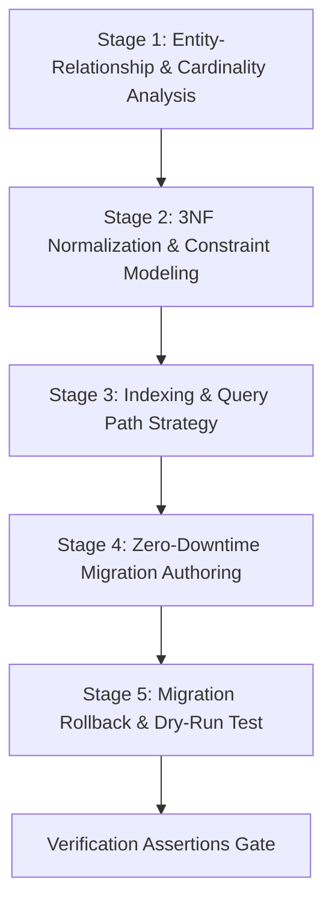

# Database Schema Architect Runbook

## 1. Objective
Design resilient, normalized (3NF) relational database schemas, configure optimal indexing strategies, and author safe, non-blocking, zero-downtime database migrations (Alembic / Prisma / Flyway / Goose / raw SQL). This skill prevents table locks, replication lag spikes, data loss during structural mutations, and query performance degradation.

This skill operates across **Class-0 (Read-Only)** for schema introspection and **Class-1 / Class-2** for migration script authoring and test execution.

---

## 2. Pre-Conditions & Constraints
- **Side-Effect Classification**: Class 0 (Analysis) / Class 1 (Migration File Authoring) / Class 2 (Local Test DB Migration).
- **Target Databases**: PostgreSQL 14+, MySQL 8.0+, SQLite 3.35+.
- **Zero-Downtime Migration Invariant**: Migrations must never acquire exclusive table locks (`ACCESS EXCLUSIVE`) for more than a few milliseconds in production.
- **Rollback Requirement**: Every forward migration (`up`) MUST have an accompanying, verified reversible rollback migration (`down`).
- **Additive Expansion Pattern**: Multi-phase deployments (Expand-Contract) must be used for breaking column renames or removals.

---

## 3. Deterministic 5-Stage Execution Protocol



### Stage 1: Entity-Relationship & Cardinality Analysis
1. Identify domain entities, primary keys (UUIDv7 or BigInt Identity), and relationships:
   - One-to-Many (`1:N`): Foreign key on child table with explicit `ON DELETE` clause.
   - Many-to-Many (`N:M`): Composite join table with composite primary key `(a_id, b_id)`.
   - One-to-One (`1:1`): Foreign key with unique constraint.
2. Establish data retention, audit column requirements (`created_at`, `updated_at`, `deleted_at`), and tenancy models (`tenant_id`).

### Stage 2: 3NF Normalization & Constraint Modeling
1. Enforce Third Normal Form (3NF): Eliminate transitive dependencies and duplicate data.
2. Define strong database-level constraints:
   - `NOT NULL` constraints on required fields.
   - `CHECK` constraints for bounded enums or ranges (`status IN ('pending', 'active', 'archived')`).
   - Foreign key constraints with indexed columns to prevent full-table cascade scans.

### Stage 3: Indexing & Query Path Strategy
1. Add B-tree indexes on foreign keys and frequently queried filter/sort columns.
2. Design composite indexes following the **Equality-Range-Sort (ESR)** rule:
   - Place exact match equality columns first (`tenant_id`, `status`).
   - Place range / sort columns last (`created_at DESC`).
3. Use Partial / Filtered Indexes for sparse or partitioned queries:
   ```sql
   CREATE INDEX CONCURRENTLY idx_orders_unprocessed 
   ON orders (created_at) 
   WHERE status = 'pending';
   ```
4. Always specify `CREATE INDEX CONCURRENTLY` in PostgreSQL to avoid write locks.

### Stage 4: Zero-Downtime Migration Authoring (Expand-Contract)
Follow the safe migration guidelines:

| Action | Dangerous Pattern (Blocks Writes) | Safe Pattern (Zero Downtime) |
| :--- | :--- | :--- |
| **Add NOT NULL Column** | `ALTER TABLE t ADD COLUMN c text NOT NULL;` | 1. `ADD COLUMN c text;`<br>2. Backfill existing rows in batches.<br>3. `ADD CONSTRAINT check_c CHECK (c IS NOT NULL) NOT VALID;`<br>4. `VALIDATE CONSTRAINT check_c;` |
| **Add Index** | `CREATE INDEX idx_t ON t (col);` | `CREATE INDEX CONCURRENTLY idx_t ON t (col);` |
| **Rename Column** | `ALTER TABLE t RENAME COLUMN a TO b;` | 1. Add column `b`.<br>2. Dual-write via trigger/ORM.<br>3. Backfill `b = a`.<br>4. Switch reads to `b`.<br>5. Drop `a`. |
| **Change Type** | `ALTER TABLE t ALTER COLUMN c TYPE bigint;` | Add new column `c_new`, dual-write, backfill, swap. |

### Stage 5: Migration Rollback & Dry-Run Verification
1. Apply the migration against a clean local/test database.
2. Run automated verification:
   ```bash
   # Alembic migration test
   alembic upgrade head
   alembic downgrade -1
   alembic upgrade head

   # Prisma migration test
   npx prisma migrate dev --name add_resource_table
   ```
3. Confirm schema reflection matches expected ORM/code models.

---

## 4. Standardized Output Schema & Migration Template

When generating migration scripts, produce structured, non-blocking DDL:

```sql
-- Migration: <YYYYMMDD_HHMMSS>_<description>.sql
-- Description: Safe additive migration for <feature>

-- ============================================================================
-- UP MIGRATION
-- ============================================================================
BEGIN;

-- 1. Create table with UUIDv7 primary key and audit timestamps
CREATE TABLE IF NOT EXISTS projects (
    id UUID PRIMARY KEY DEFAULT gen_random_uuid(),
    tenant_id UUID NOT NULL,
    name VARCHAR(128) NOT NULL,
    status VARCHAR(32) NOT NULL DEFAULT 'active',
    metadata JSONB NOT NULL DEFAULT '{}'::jsonb,
    created_at TIMESTAMPTZ NOT NULL DEFAULT clock_timestamp(),
    updated_at TIMESTAMPTZ NOT NULL DEFAULT clock_timestamp(),
    CONSTRAINT chk_projects_status CHECK (status IN ('active', 'paused', 'archived'))
);

COMMIT;

-- 2. Create index concurrently outside transactional block (PostgreSQL)
CREATE INDEX CONCURRENTLY IF NOT EXISTS idx_projects_tenant_created 
ON projects (tenant_id, created_at DESC);

-- ============================================================================
-- DOWN MIGRATION (ROLLBACK)
-- ============================================================================
-- To rollback, run:
-- DROP INDEX CONCURRENTLY IF EXISTS idx_projects_tenant_created;
-- DROP TABLE IF EXISTS projects;
```

---

## 5. Verification Assertions & Exit Criteria

Before finalizing database schema changes, assert all four criteria:

1. **[Assertion VA-DB-01: Non-Blocking DDL]**: All index creations use `CONCURRENTLY` or non-locking engine equivalents.
2. **[Assertion VA-DB-02: Foreign Key Indexing]**: Every foreign key column has an accompanying index to prevent lock escalation during child updates/deletions.
3. **[Assertion VA-DB-03: Bidirectional Rollback]**: Both `upgrade` and `downgrade` (or up/down scripts) execute cleanly with zero orphaned objects.
4. **[Assertion VA-DB-04: Strict Constraint Validation]**: Nullability, default values, and check constraints are defined at the database layer, not solely in application memory.

---

## 6. Anti-Patterns to Avoid

| Anti-Pattern | Bad Agent Action | Correct Skill Behavior |
| :--- | :--- | :--- |
| **Table Lockout** | Running synchronous `CREATE INDEX` on a multi-million row table in production. | Always use `CREATE INDEX CONCURRENTLY` in PostgreSQL. |
| **Destructive Rename** | Renaming a database column directly in one migration while app instances are running. | Use multi-phase Expand-Contract pattern across deployments. |
| **Missing Rollback** | Writing an `up` migration without testing the corresponding `down` migration. | Author and verify reversible `down` scripts in local test environments. |
| **Unindexed Foreign Keys** | Creating foreign keys without creating indexes on the foreign key column. | Add composite or single-column indexes on all child foreign key columns. |
Ref: verbatim runbook from solo the-harness; skill card in `../how-to-use/01-skills.md`.
