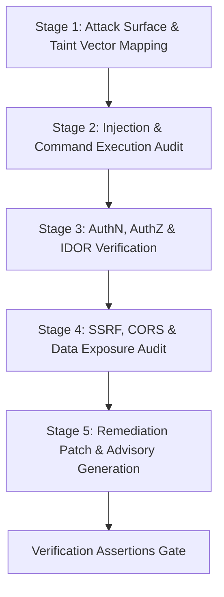

# OWASP Top 10 Vulnerability Scanner & Security Review Runbook

## 1. Objective
Execute a deterministic, hermetic static application security testing (SAST) and code review pass across source code, API routes, database queries, and configuration files. Identify, categorize, and remediate OWASP Top 10 (and CWE top 25) security vulnerabilities before code merges to production.

This skill operates in **Class-0 (Read-Only)** mode during discovery and **Class-1 (Idempotent Mutation)** during remediation patch authoring.

---

## 2. Pre-Conditions & Constraints
- **Side-Effect Classification**: Class 0 (Security Audit) / Class 1 (Remediation Patches).
- **Scope**: Source code, dependencies, Dockerfiles, cloud templates, API endpoints.
- **Hermetic Secret Invariant**: Never expose, log, or hardcode plaintext credentials, JWT signing secrets, or private keys during review or patch generation.
- **Zero-Tolerance Criteria**: Any critical injection (SQLi, Command Injection, SSRF) or authentication bypass must immediately halt deployment.

---

## 3. Deterministic 5-Stage Execution Protocol



### Stage 1: Attack Surface & Taint Vector Mapping
1. Identify all untrusted external input entrypoints:
   - HTTP route parameters (`params`, `query`, `body`, `headers`, `cookies`).
   - Message broker consumers (Kafka, RabbitMQ, SQS payloads).
   - File uploads, multipart parsers, webhooks.
   - CLI arguments and environment variables.
2. Trace taint flow from input sources to critical sinks (DB queries, OS shell execution, filesystem reads, HTTP client calls).

### Stage 2: Injection & Command Execution Audit (A03:2021)
1. **SQL Injection (SQLi)**:
   - Search for string interpolation/concatenation in SQL:
     ```bash
     grep -rn "execute(.*f"" src/ || grep -rn "query(.*\+" src/
     ```
   - Enforce parameterized queries (`execute("SELECT * FROM u WHERE id = $1", [id])`) or type-safe ORMs.
2. **Command Injection**:
   - Check `subprocess.Popen(..., shell=True)`, `os.system()`, `exec()`, `eval()`.
   - Ensure arguments are passed as explicit lists (`["git", "status"]`) with `shell=False`.
3. **Cross-Site Scripting (XSS)**:
   - Check `dangerouslySetInnerHTML`, unescaped template variables, or unvalidated `innerHTML`.

### Stage 3: Authentication, Authorization & IDOR Verification (A01:2021 & A07:2021)
1. **Insecure Direct Object References (IDOR)**:
   - Verify every endpoint fetching resources by ID (`/api/documents/{docId}`) validates ownership against `currentUser.tenant_id` or `currentUser.id`.
2. **Broken Authentication**:
   - Verify passwords use Argon2id or bcrypt ($cost \ge 12$).
   - Check session cookies: `HttpOnly`, `Secure`, `SameSite=Strict` or `Lax`.
   - Ensure JWT algorithms are explicitly pinned (`algorithms=["RS256"]`), rejecting `none` algorithm.

### Stage 4: SSRF, CORS & Data Exposure Audit (A10:2021 & A05:2021)
1. **Server-Side Request Forgery (SSRF)**:
   - Verify outbound HTTP requests containing user URLs block private RFC 1918 addresses (`10.0.0.0/8`, `172.16.0.0/12`, `192.168.0.0/16`, `127.0.0.1`, `169.254.169.254` cloud metadata).
2. **Security Misconfiguration**:
   - Check CORS policies: Reject `Access-Control-Allow-Origin: *` when credentials are enabled.
   - Check debug flags: Ensure `DEBUG = False` in production configs.

### Stage 5: Remediation Patch & Advisory Generation
1. Formulate defensive coding replacements.
2. Run security scanner checks:
   ```bash
   # Python Bandit security scan
   bandit -r src/ -ll

   # Node.js audit & Semgrep
   npm audit && npx semgrep --config=auto src/
   ```

---

## 4. Standardized Output Schema (`SECURITY_AUDIT_REPORT.md`)

When executing this security review, generate structured vulnerability findings:

```markdown
# Security Audit Report: <Component Name>

> **Date:** <YYYY-MM-DD> | **Scanner:** OWASP Top 10 Review Engine
> **Status:** <PASS / FAIL (Vulnerabilities Found)>

---

## 1. Vulnerability Summary Matrix

| ID | Vulnerability Category | Severity | Location | CWE | Status |
| :--- | :--- | :--- | :--- | :--- | :--- |
| **SEC-01** | SQL Injection | **CRITICAL** | `src/api/users.py:42` | CWE-89 | 🔴 Remediation Required |
| **SEC-02** | Insecure Direct Object Ref (IDOR) | **HIGH** | `src/api/docs.py:88` | CWE-639 | 🔴 Remediation Required |
| **SEC-03** | Missing HttpOnly Cookie Flag | **LOW** | `src/auth/session.py:15` | CWE-1004 | 🟢 Fixed in Patch |

---

## 2. Detailed Findings & Remediation Patches

### Finding SEC-01: SQL Injection in User Query
- **Severity**: CRITICAL (CVSS 9.8)
- **Vulnerable Code**:
  ```python
  # Vulnerable: string format in raw SQL
  cursor.execute(f"SELECT * FROM users WHERE email = '{user_email}'")
  ```
- **Remediation Patch**:
  ```python
  # Secure: Parameterized query binding
  cursor.execute("SELECT * FROM users WHERE email = %s", (user_email,))
  ```
- **Impact**: Prevents full authentication bypass and unauthorized data exfiltration.
```

---

## 5. Verification Assertions & Exit Criteria

Before declaring a security review complete, assert all four criteria:

1. **[Assertion VA-SEC-01: Zero Critical Sinks]**: All dynamic database queries and shell executions use parameterized bindings and list arguments without shell interpretation.
2. **[Assertion VA-SEC-02: Tenancy & Ownership Enforced]**: All resource fetch and mutation handlers enforce tenant/user ownership assertions before execution.
3. **[Assertion VA-SEC-03: Secret Hygiene Maintained]**: No API tokens, cryptographic private keys, or passwords exist in plaintext anywhere in the diff.
4. **[Assertion VA-SEC-04: Static Analysis Clean]**: Automated SAST tools (Bandit/Semgrep/ESLint security) report 0 high or critical severity violations.

---

## 6. Anti-Patterns to Avoid

| Anti-Pattern | Bad Agent Action | Correct Skill Behavior |
| :--- | :--- | :--- |
| **Regex Sanitization for SQL** | Replacing quotes with regex instead of parameterization. | Always use native DB driver parameterized query placeholders. |
| **Client-Only AuthZ** | Hiding UI buttons but leaving backend endpoints accessible by ID. | Enforce server-side authorization checks on every endpoint handler. |
| **Permissive Wildcards** | Setting `Access-Control-Allow-Origin: *` with `Allow-Credentials: true`. | Validate origin against an explicit domain allowlist. |
| **Silent Ignored Exceptions** | Wrapping security checks in `try: ... except: pass`. | Fail closed on any authorization or token validation error. |
Ref: verbatim runbook from solo the-harness; skill card in `../how-to-use/01-skills.md`.
