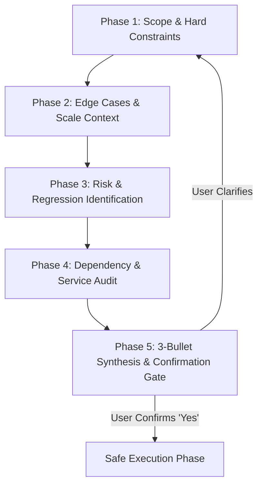

# Grill-Me Socratic Planner Runbook

## Objective
Execute a disciplined, proactive requirements interview protocol before writing a single line of implementation code. This runbook prevents architectural divergence, uncovers hidden edge cases and non-functional requirements, eliminates hallucinated assumptions, and secures explicit alignment between the user and autonomous agent workflows.

---

## When to Activate
- When the user provides a high-level, ambiguous, or multi-faceted feature request (e.g., "build an authentication system", "add webhook notifications", "refactor our data models").
- Before initiating major multi-file architectural refactors or schema migrations.
- When critical constraints (language version, framework choices, throughput targets, security boundaries) are unstated.
- When the user explicitly triggers planning phrases such as `"grill me"`, `"interview me"`, `"plan this"`, or `"clarify requirements"`.

---

## Step-by-Step Runbook

The Socratic Interview Protocol proceeds deterministically through five structured phases. **Strict Invariant**: Do not write, generate, or mutate codebase implementation files until Phase 5 alignment is explicitly confirmed by the user.

---

### Phase 1 — Scope & Constraint Extraction
Ask the foundational scope questions upfront in a single structured prompt before proposing solutions:

1. **Success Criterion**: *"What is the exact, verifiable success criterion for this task? (How will we know it is 100% done and working?)"*
2. **Hard Technical Constraints**: *"What are the hard constraints regarding programming language version, framework ecosystem, storage engine, and deployment target?"*
3. **Input / Output Contract**: *"What exact inputs (schemas, payloads, parameters) will this component receive, and what exact outputs, status codes, or side-effects must it produce?"*

---

### Phase 2 — Edge Case & Scale Excavation
Probe boundary conditions, error flows, and operational scale:

1. **Null & Malformed Inputs**: *"What specific behavior is expected when inputs are empty, null, partially formatted, or excessively large?"*
2. **Scale & Performance**: *"What are the expected throughput (requests/sec), data volumes (records/tables), and latency SLAs?"*
3. **Security & Tenancy**: *"What security context applies? Is this endpoint public-facing, internal-only, multi-tenant isolated, or protected by specific RBAC scopes?"*

---

### Phase 3 — Risk Identification & Safety Isolation
Identify collateral risks, breaking changes, and rollback strategies:

1. **Rollback Plan**: *"What is the rollback mechanism if this change fails or causes production instability (e.g., feature flag, database migration rollback, git revert)?"*
2. **Regression Invariants**: *"Are there existing legacy tests, database records, or public API contracts that must strictly not break during this implementation?"*

---

### Phase 4 — Dependency & Boundary Audit
Audit third-party integrations, external systems, and rate limits:

1. **External Services**: *"What third-party APIs, external microservices, cloud resources, or message queues does this feature interact with?"*
2. **Rate Limits & SLAs**: *"Are there upstream provider rate limits, quotas, webhook retry policies, or timeout constraints we must design around?"*

---

### Phase 5 — Alignment Confirmation & Go/No-Go Gate
Synthesize the entire interview findings into **exactly three concise bullet points** and present the confirmation gate to the user:

1. **Target Deliverable & Behavior**: High-level summary of what will be built and the exact verification criteria.
2. **Architecture & Constraints**: Selected stack, component boundaries, and key design decisions.
3. **Safety & Risk Mitigation**: Rollback strategy, error handling semantics, and non-regression guarantees.

#### Mandatory Gate Prompt:
> **Alignment Check**:
> - **Deliverable**: `<1-sentence concise scope summary>`
> - **Architecture**: `<1-sentence constraints & technical choices>`
> - **Safety**: `<1-sentence test coverage & rollback strategy>`
>
> *"Is this understanding correct and complete? Please confirm with 'proceed' or provide corrections before I write any code."*

---

## Completion Gate
Before exiting the Socratic Planning phase and entering execution:
- [ ] **All 5 phases addressed**: Scope, edge cases, risks, dependencies, and alignment synthesis were systematically evaluated.
- [ ] **Zero unstated assumptions**: Critical technical constraints (frameworks, versions, payload contracts) are explicitly recorded.
- [ ] **Rollback strategy documented**: Verification steps and rollback procedures are identified.
- [ ] **3-Bullet summary delivered**: User was presented with the 3-bullet synthesis.
- [ ] **Explicit confirmation received**: User responded with affirmative confirmation to proceed.

---

## Common Pitfalls

| Anti-Pattern | Bad Agent Action | Correct Socratic Behavior |
| :--- | :--- | :--- |
| **Premature Coding** | Writing code immediately after a 1-sentence user request | Execute Phase 1-5 interview to lock requirements first |
| **Scattered Interrogations** | Asking 15 separate single-question prompts across 15 turns | Batch questions into structured phases |
| **Hallucinated Tech Choices** | Assuming MongoDB when repository uses PostgreSQL | Extract hard constraints in Phase 1 before choosing libraries |
| **Ignoring Regressions** | Modifying shared models without checking existing consumers | Audit invariants and test suites in Phase 3 |
| **Vague Confirmation** | Asking "Looks good?" without summarizing findings | Provide structured 3-bullet synthesis and explicit confirmation question |
Ref: verbatim runbook from solo the-harness; skill card in `../how-to-use/01-skills.md`.
